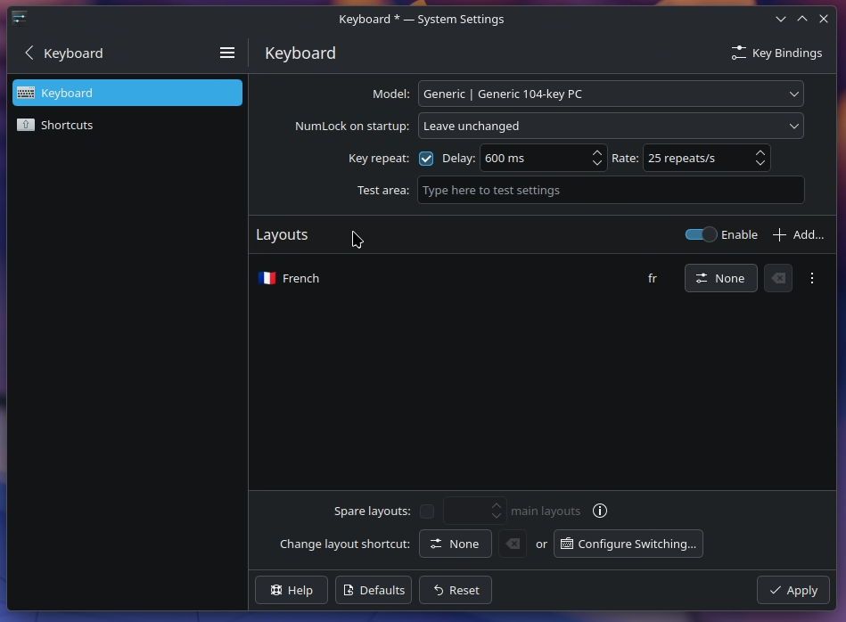

# Common configuration while Streaming

You can configure your keyboard and mouse after connecting with Moonlight using bottom toolbar Keyboard and Mouse icons.

## Keyboard configuration and layout

**Keyboard layout (_QWERTY_, _AZERTY_, etc.)**

Click on keyboard icon at the bottom of screen:
- Click on _Enable_ toggle
- Click _+ Add_ button and select your layout
- Remove layout you don't need: at the right of layout's name, click on 3-dots menu and _remove_ 

**Keyboard model**

Your keyboard model might vary depending on your hardware and OS: Windows, MacOS, Linux...

Choose your **Model:** select _model_ dropdwon and
  - **Windows**: use Generic PC-104 or PC-105
  - **MacOS**: use Macbook or Macintosh
  - **Linux**: use Generic PC-104 or PC-105
  - If none of the above work, try to find your keyboard manufacturer in the list

## Mouse configuration

Set your mouse configuration (eg. pointer speed) after connecting with Moonlight: click on the Mouse icon at the bottom of the screen. Adapt configurations as per your needs.
